<p align="center">
  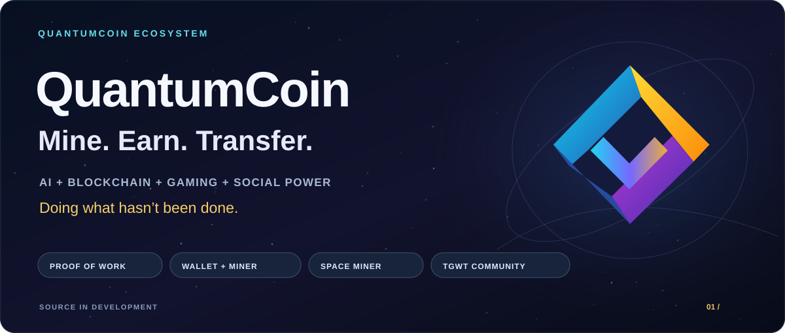
</p>

<p align="center">
  <strong>A connected world for miners, players and builders.</strong><br>
  “Doing what hasn't been done.”
</p>

<p align="center">
  <a href="#ecosystem">Ecosystem</a> ·
  <a href="#space-miner">Space Miner</a> ·
  <a href="#tgwt">TGWT</a> ·
  <a href="#nft-rewards">NFT Rewards</a> ·
  <a href="#token-factory">Token Factory</a> ·
  <a href="#roadmap">Roadmap</a> ·
  <a href="#build">Build &amp; Test</a>
</p>

QuantumCoin brings together a mineable Proof-of-Work blockchain, wallet-based
rewards, cinematic gaming, AI-assisted tools and community participation.
The goal is one ecosystem where mining, ownership, blockchain records and game
activity work together through clear, verifiable rules.

**Project stage:** active development and pre-production validation. The core
source includes tested runtime components; game content, external deployments and
public release preparation continue alongside them.

<a id="ecosystem"></a>

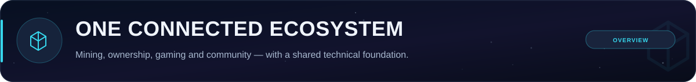

### What is QuantumCoin?

QuantumCoin is a mineable blockchain ecosystem built around:

- **Wallet-based mining:** a direct connection between the user, miner and chain.
- **QC transactions and records:** validated transfers, balances and persisted state.
- **Cinematic Web3 gaming:** Telegram Space Miner and a lunar mining world.
- **Community incentives:** TGWT, watch tasks and verified engagement workflows.
- **Evidence-based NFT awards:** activity, wallet control, draw evidence and signed approvals.
- **AI-assisted insight:** telemetry, analysis, recommendations and monitoring support.
- **Social power:** content tools, community participation and multilingual growth.

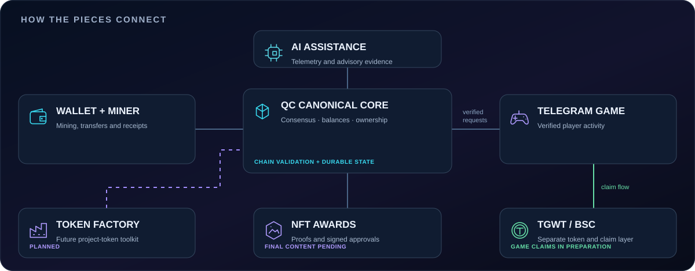

The native QC chain governs QC balances and accepted NFT ownership. TGWT uses a
separate BNB Smart Chain token/claim layer connected to the game. AI provides
advisory evidence; the chain's validation rules remain authoritative.

<a id="wallet-miner"></a>

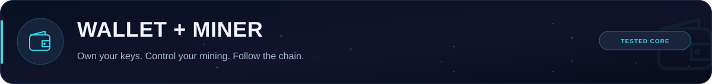

The wallet and miner form the core user runtime: create or use a wallet, start
mining, follow the balance and transaction flow, and send or receive QC through
the supported interface.

**Working and tested source milestones**

- Start/stop mining and wallet-based mining launch.
- Send/receive API contracts and balance/receipt handling.
- Shared backend startup coordination for the Windows desktop interface.
- Block, transaction and reward validation against canonical chain rules.
- Durable chain writes, reload checks and recovery behavior.

Windows desktop builds use Fyne and require a working CGO/C compiler environment.
Release launch/check scripts and the control-panel sources live in `release/`.
This source update does not publish a new binary release.

<a id="space-miner"></a>

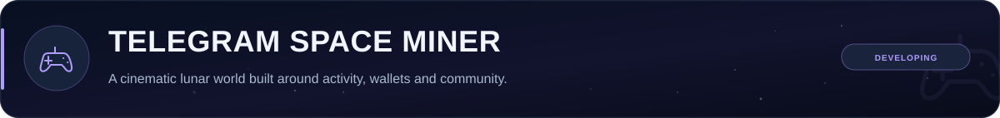

**Telegram Space Miner is the cinematic GameFi entry point of QuantumCoin.**
It brings a lunar setting, mining sessions, wallet panels and community rewards
into a game interface. Verified gameplay and wallet evidence connect the reward
workflow to the underlying technical controls.

| Current game structure | Continuing development |
|---|---|
| Moon mining map and LUNA zones | LUNA-01 to LUNA-05 transition videos |
| Wallet and TGWT panel structure | Deeper mining gameplay and visual polish |
| Cinematic intro and return-to-map flow | Player-facing wallet challenge signing |
| Authenticated activity/session controls | Operational wallet/game reward rollout |
| Multilingual interface structure | Further content and onboarding improvements |

**Cinematic journey:** Launch screen → Cockpit intro → Moon overview → Mining map.

<table>
  <tr>
    <td align="center" width="50%">
      <br>
      <strong>QuantumCoin identity</strong><br>
      <sub>Original project logo</sub>
    </td>
    <td align="center" width="50%">
      <br>
      <strong>The lunar setting</strong><br>
      <sub>Moon environment asset from the game source</sub>
    </td>
  </tr>
</table>

<a id="ai-network"></a>

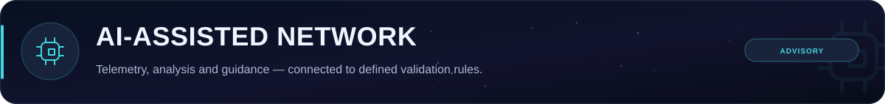

AI is being developed as an assistant layer for users and operators. The source
contains analysis and advisory components, with further monitoring and automation
work planned around the ecosystem.

| Area | Direction |
|---|---|
| Network and miner telemetry | Understand runtime behavior and operational signals. |
| Wallet/reward analysis | Provide guidance using the canonical ledger context. |
| Anomaly detection | Support review of unusual activity and safety signals. |
| User recommendations | Improve guidance and troubleshooting. |
| Content and automation | Assist planning and community workflows. |

AI output cannot independently increase QC supply, change chain balances or
bypass the configured approval and validation rules.

<a id="community"></a>

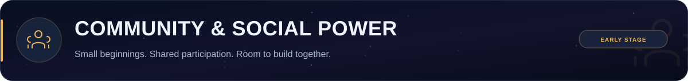

QuantumCoin is growing from a small early community. There is room for players,
testers, developers and content contributors to help shape the experience.
Participation and useful feedback are part of how the project develops.

Community directions include:

- AI-assisted content planning and social content workflows.
- YouTube, X and Telegram tooling, with future channel expansion such as TikTok.
- English, Turkish, Spanish and Chinese language support in the project structure.
- Verified watch/social activity and TGWT incentive workflows.
- Future community governance and on-chain voting concepts.

External publishing needs operator accounts, credentials and service setup.
Community reward eligibility and settlement also have their own verification steps.

<a id="tgwt"></a>

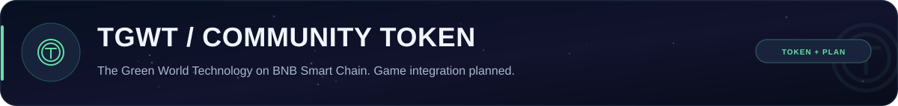

### A community token for the Telegram Game direction

| TGWT information | Details |
|---|---|
| On-chain name | **The Green World Technology** |
| Symbol | **TGWT** |
| Network | **BNB Smart Chain mainnet — chain ID 56** |
| Contract | [`0xbc70225507b132e9926c9b09c14ff4f87f6d5451`](https://bscscan.com/token/0xbc70225507b132e9926c9b09c14ff4f87f6d5451) |
| Game distribution | **Planned: earn reward tokens without purchasing them in the game.** |

TGWT is intended to support qualifying gameplay, eligible community tasks and
watch/engagement incentives. With a small early community, there is room for the
game, participation and incentive features to develop together.

The reward/claim integration is still being prepared. The current BSC claim
configuration is disabled by default. When on-chain claims are enabled, users
may need to pay BNB network gas even though the reward tokens are earned without
purchasing them in the game.

TGWT is separate from native QC. A verified game ledger entry and a completed
BSC transfer are different stages of the reward/claim process.

<a id="nft-rewards"></a>

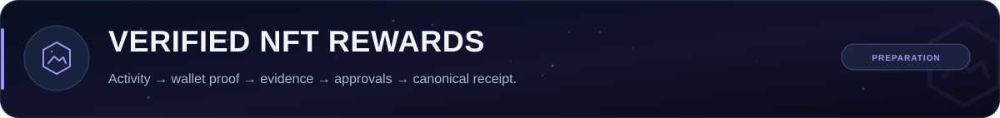

The monthly NFT program links **twelve active award periods** to **one rare NFT
per period**. Actual award dates derive from the verified program activation.

**The technical award path**

1. Authenticate the player and derive activity from server records.
2. Review the candidate and verify a one-use wallet-control challenge.
3. Freeze the eligible pool and publish its commitment before a fixed future beacon round.
4. Verify the independent witness record and the beacon's BLS signature.
5. Select the winner without modulo bias and persist the evidence.
6. Validate final content and distinct authorized AI/admin approval signatures.
7. Submit the signed award and confirm a persisted canonical node receipt.

| Ready in source | Preparation still required |
|---|---|
| Independent witness service and HTTPS adapter | Independent operator, host and real keys |
| Fixed-round beacon verification and publication recovery | Pinned operational network configuration |
| Catalog checks and final approval preparation | Twelve actual final images/metadata and signed approvals |
| Controlled mint/receipt and reconciliation flow | Final operational rollout and player wallet-signing UX |

The checked-in catalog is a draft. Missing evidence blocks mint authorization.
Retired automatic miner NFT/annual bonus paths stay disabled. If a receipt
disappears from the canonical chain, the game enters reconciliation rather than
automatically minting a replacement.

[Reward lifecycle](docs/NFT_REWARD_LIFECYCLE.md) ·
[Final content preparation](docs/NFT_FINAL_PREPARATION.md) ·
[Independent witness deployment](nft/preproduction/INDEPENDENT-WITNESS.md)

<a id="security"></a>

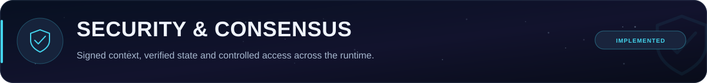

Recent source work strengthens the connection between policy and runtime behavior:

- Canonical block/transaction validation and signed protocol activation context.
- API authentication, CORS enforcement, bounded requests and endpoint contracts.
- Peer message limits, network identity and connection lifecycle handling.
- Persisted chain state, restart/reload checks and replacement/reorganization behavior.
- Token authorization, address validation, registry integrity and durable state.
- Exact fee accounting, burn handling and founder binding/vesting checks.
- Durable worker claims, leases, retry/idempotency controls and recovery policies.

Security and release validation continue as the project moves toward operational
testnet readiness. Automated/advisory tools use defined permissions and evidence;
accepted chain state determines balances and ownership.

<a id="economy"></a>

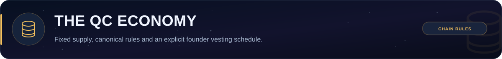

| Canonical parameter | Current source rule |
|---|---|
| Native coin | **QC** |
| Total supply | **25,500,000 QC** |
| Initial mining reward | **50 QC** |
| Coinbase maturity | **10 blocks** |
| Founder allocation | **5% — 1,275,000 QC** |
| Founder liquid allocation | **1% — 255,000 QC** |
| Founder locked allocation | **4% — 1,020,000 QC** |
| Founder vesting | **12-month cliff, then 48 monthly unlocks** |
| Monthly unlock after the cliff | **21,250 QC** |
| Remaining network allocation | **95%** |

The authoritative constants are in
[`consensus/canonical_economy_policy_v1.go`](consensus/canonical_economy_policy_v1.go).
Read these alongside denomination, burn, activation and founder-binding rules.
Game, AI, TGWT and automation components cannot independently expand QC supply.

<a id="token-factory"></a>

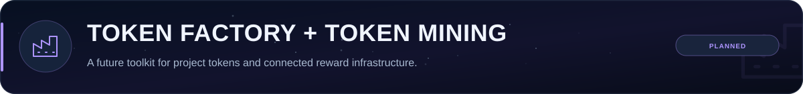

Once the core infrastructure is ready, we plan to add a **Token Factory** and a
connected **token mining/reward infrastructure** for project tokens.

Planned capabilities include:

- Token creation tools built on the supported token framework.
- Project-specific issuance permissions, supply limits and reward rules.
- Token mining/reward flows with validated activity and recorded distribution.
- Wallet/game views for token balances and eligible rewards.

Existing QC20/QC721 authorization and persistence components provide a foundation.
The public token-creation workflow and token-mining service are **future work**.
Their model, operating requirements and launch conditions will be defined and
tested before release. Project tokens retain their own rules and cannot override
QC's fixed-supply and consensus restrictions.

<a id="roadmap"></a>

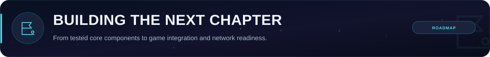

| Stage | Focus | Current position |
|---|---|---|
| **Core runtime** | Wallet/miner, transfers, canonical chain state and persistence | Implemented and tested source milestones |
| **Game integration** | Cinematic intro, LUNA zones, session flow and player wallet experience | Interface and verified activity infrastructure present; gameplay/content developing |
| **Community & rewards** | TGWT, watch/social verification and evidence-based NFT awards | Technical controls present; external rollout and final inputs pending |
| **Testnet readiness** | Network/API checks, configuration, recovery, security and packaging | Operational preparation continues |
| **Token creation & mining** | Token Factory and connected project-token reward infrastructure | Planned once the core is ready |
| **Mainnet direction** | Final validation, operator readiness, release packaging and onboarding | Requires its own completion and launch decisions |

Explorer, broader incentive products, staking, governance and mobile experiences
remain separate development areas.

<a id="build"></a>

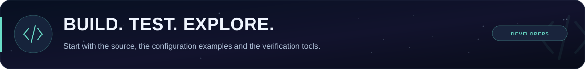

### Source layout

| Directory | Purpose |
|---|---|
| `consensus/`, `blockchain/`, `node/` | Protocol, canonical ledger and node runtime |
| `wallet/`, `miner/`, `cmd/` | Wallet/mining runtime and desktop/CLI entry points |
| `api/`, `p2p/`, `security/` | HTTP contracts, peer transport and runtime guardrails |
| `token/` | Token permissions, ownership and registry state |
| `persistence/`, `queueworker/`, `backuprestore/` | State, durable work and recovery controls |
| `nft/`, `telegram_game/` | Reward evidence, draft catalog and game integration |
| `socialbot/`, `autopublisher/` | Community content/distribution tools |
| `configs/`, `release/`, `docs/` | Examples, launch/check sources and feature guides |

### Build the core

The latest Windows source validation used **Go 1.24.5**. The module declaration
is in [`go.mod`](go.mod). Desktop builds need CGO, a C compiler and the Fyne/OpenGL
environment. Python services should run in an isolated environment.

```powershell
git clone https://github.com/QuantumCoinNews/quantumcoin.git
cd quantumcoin
go build ./...
go test ./... -count=1
```

### Game and NFT evidence dependencies

```powershell
python -m venv .venv
.\.venv\Scripts\Activate.ps1
python -m pip install -r telegram_game/requirements.txt -r telegram_game/requirements-nft-witness.txt
python scripts/monthly_nft_catalog_v1.py --check
python scripts/test_monthly_nft_catalog_v1.py
```

Use the example configurations as preparation inputs and supply real operator
values separately. Keep wallet keys, credentials and runtime databases out of
source control.

### Verification milestones

**1,088 Go tests across 24 tested packages** and **23 isolated Python regression
scripts** passed for the integrated runtime, including the game-to-Go-node
mint/receipt flow. Launch/check PowerShell sources were syntax-checked.
These counts describe software verification, not live users or network adoption.

[Runtime integration](docs/RUNTIME_INTEGRATION.md) ·
[Verification coverage](docs/NFT_RUNTIME_TEST_COVERAGE.md) ·
[Draft catalog tools](docs/NFT_CATALOG.md)

---

<p align="center">
  <strong>Real mining. Wallet-based rewards. Verifiable blockchain records.</strong><br>
  QuantumCoin — Mine. Earn. Transfer.<br><br>
  <sub>Experimental software under active development · MIT, as stated by the project</sub>
</p>
