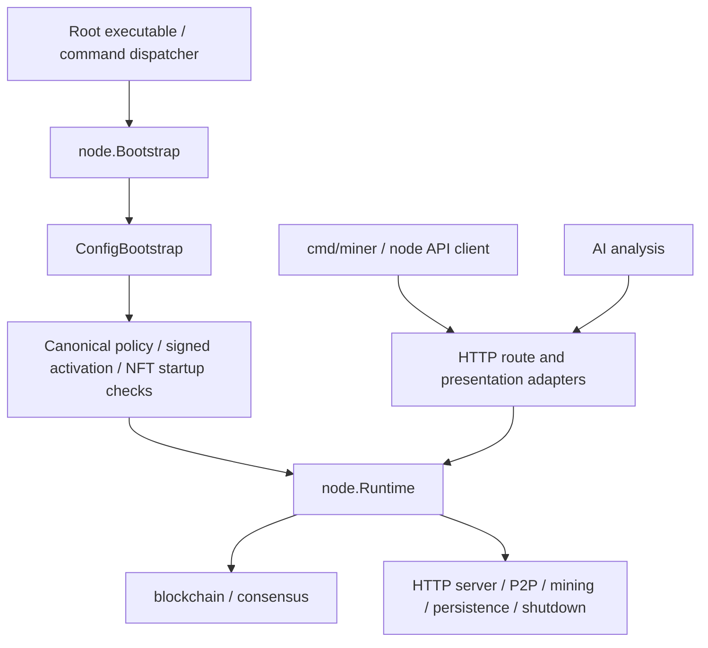

# Runtime entry points and service ownership

The production node executable has one entry: root `main.go` delegates to
`runNodeCLI` in `node_app_cli.go`. Build the root package with `go build .`
or `go build -o quantumcoin.exe .`; development execution uses `go run .`.
Building or running a single source file does not include the application.
Help, command validation and offline wallet creation return before node
bootstrap. See [CLI paths and offline commands](CLI_PATHS_AND_OFFLINE_COMMANDS.md)
for caller-relative paths, explicit data/config options and wallet migration.

## Authority and lifecycle

| Component | Responsibility and boundary |
| --- | --- |
| `node.Bootstrap` / `BootstrapWithConfig` | Validate configuration, network profile, canonical economic policy, signed hardfork activation and NFT startup context before opening the chain or starting services. Explicit mainnet readiness blocks continue to apply. |
| `node.Runtime` | Own the shared chain/configuration, HTTP server, P2P server, in-process miner, reload, autosave and graceful shutdown. Constructing `NewRuntime` alone does not authorize a production startup. |
| `blockchain` / `consensus` | Validate transactions, blocks, ownership and economic state. Only accepted canonical ledger transitions establish balances, issuance or NFT ownership. |
| Root command and HTTP adapters | Parse CLI/HTTP inputs, register routes, enforce transport controls, call canonical services and present results. They do not construct another blockchain or listener. |
| `miner` / `cmd/miner` | Authenticated client of the node's canonical job and submit endpoints. The old file-writing adapter is retained as a compatibility library for isolated tooling. The command supports node work and mock mode. |
| `api` | Compatibility symbols only. `Init` retains no service state; `StartHTTP` always returns the retirement error and cannot bind a port. |
| `internal` | Compatibility delegates to canonical chain/mempool/economic operations. It does not own a second monetary ledger. |
| Gameplay, AI and explorer presentation | Telegram Game owns gameplay. AI alerts and explorer projections consume node state as advisory or presentation data. Monthly NFT awards require verified evidence and the canonical ledger path. |
| Wallet and Telegram applications | Separate clients/processes. Wallets sign locally and submit signed public transactions through authenticated HTTP. Their local UI/database state is not consensus state. |

Root adapters capture the chain through `Runtime.Snapshot` for each operation;
there is no global `bc` pointer to replace during reload. `cfg` is immutable
startup configuration. See [chain concurrency and persistence](CHAIN_CONCURRENCY_AND_PERSISTENCE.md)
for service pinning, shared writer locks and atomic chain-file installation.

## Root adapter modules

| File | Scope |
| --- | --- |
| `main.go` | Executable entry only |
| `node_app_cli.go` | Existing positional command dispatch and bootstrap ordering |
| `node_app_context.go` | Runtime reference, immutable configuration and advisory presentation state |
| `node_app_config.go` | Address, network binding and miner configuration adapters |
| `node_app_types.go`, `node_app_amounts.go` | Transport DTOs and exact QC input parsing |
| `node_app_http.go`, `node_app_router.go` | Response/auth/CORS helpers, route composition and runtime HTTP delegation |
| `node_app_transactions.go`, `node_app_wallet.go` | Transaction/burn/stake transport and wallet/balance transport |
| `node_app_mining.go`, `node_app_webminer.go` | In-process mining controls and web-work transport |
| `node_app_lifecycle.go` | Autosave/reload and signal/shutdown adapters |
| `node_app_telemetry.go`, `node_app_explorer.go` | Health/economy telemetry and bounded explorer reads |
| `node_app_security.go`, `node_app_advisory.go` | Security presentation and AI reads |

Other existing root adapter files continue to implement their named transport
contracts. The modules above remain in `package main` so route handlers and
existing integration tests retain the same interfaces.

## Compatibility and verification

The initial module split preserved command and transport contracts. Subsequent
security migrations are documented in [API and wallet contracts](API_WALLET_AND_SERVICE_CONTRACTS.md),
including signed-only transaction HTTP and retired HTTP key generation.
API-only mode continues to stop only
its HTTP server and does not gain autosave/final-save behavior. Full node shutdown
continues through `node.Runtime.Shutdown`.

Observer API mode additionally denies application mutations through an explicit
read capability boundary. See [read-only API mode](API_READ_ONLY_MODE.md) for
the route policy, signed receipt exception and error contracts.

Every startup mode now requires full chain validation before constructing a
runtime, independently of the legacy strict-chain flag. See
[chain startup validation](CHAIN_STARTUP_VALIDATION.md) for admission and failure
behavior.

Architecture tests enforce the thin entry, canonical bootstrap ordering, absence
of independent root chain/listener construction and standalone-miner delegation.
Existing route, policy, persistence, mining and shutdown regressions exercise the
same application assembled from the split files. Source contracts inspect all
application adapters rather than assuming every function resides in `main.go`.

Run `go test ./... -race -count=1` for the full Go regression suite. A separately
recorded AST comparison confirmed that the initial split preserved all 101
declarations, with only `main` renamed to `runNodeCLI` behind the entry wrapper.
Subsequent authorization, startup validation and concurrency changes are
described in the linked service-boundary documents.

Real NFT artwork, live operator deployment, approvals and mainnet readiness remain
their existing separate release prerequisites.

Miner address selection uses one read-only policy across node adapters and the
native wallet launcher; see [miner address policy](MINER_ADDRESS_POLICY.md).
The default root build has no Fyne imports. Optional GUI checks and the native
wallet have separate commands. See [dependency boundaries and audit](DEPENDENCY_BOUNDARIES_AND_AUDIT.md)
for the social JavaScript graph, headless cross-build matrix and the remaining
dependency/security release gate.

Browser mining submits actual canonical block PoW and acknowledges only a local
durable commit. Default CLI startup does not mine or generate an unbacked reward
address. See [browser mining and safe startup](WEB_MINING_AND_SAFE_STARTUP.md)
for the protocol, lifecycle and migration contract.

See [endpoint ownership](ENDPOINT_OWNERSHIP.md) and
[runtime policy package decisions](RUNTIME_POLICY_PACKAGE_DECISIONS.md) for the
current route and import inventories.
