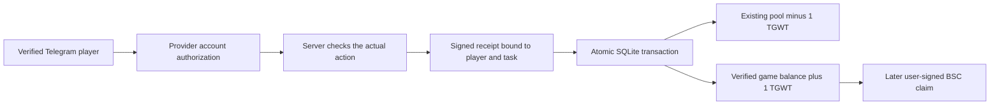

# TGWT verified task rewards and real client mining

The existing total reward pool is **3,000,000 TGWT**. Its canonical definition is
`tgwt_pool_policy.py`; the runtime and evidence validator import that definition.
The existing SQLite `tgwt_pool` row with `id=1` remains the accounting pool.
There is no second pool and no balance reset during startup or this migration.

Each verified task earns **exactly 1 TGWT** (`TGWT_TASK_REWARD_U`). X follow,
X like, YouTube subscription, Telegram membership and later platforms are separate
tasks/campaigns. They share the total pool. Client amount, nonce and request ID
cannot set a reward. Campaign creation and redemption both enforce this amount.

One game TGWT unit has 1,000,000 internal micro-units. This is an off-chain
accounting denomination, not a claim about the deployed token contract's decimals.
On-chain conversion must validate the actual contract in the later claim stage.

## What is live in the code

| Operation | Authority and evidence | Result |
|---|---|---|
| Social/watch/store claim | Authenticated Telegram actor plus signed provider receipt | One verified task credit, or no change |
| Generic TGWT earn/verify | Retired even for operators | HTTP 410, no balance change |
| Campaign registration/state | Separately authenticated operator | Immutable policy / enable-disable only |
| X follow/like | OAuth user identity plus read-only X API action check | Signed server evidence, then atomic task credit |
| Telegram join | Authenticated Telegram actor plus Bot API `getChatMember` | Server-side member status check, then one atomic task credit |
| YouTube subscription | OAuth user identity plus read-only subscription API check | Signed server evidence, then atomic task credit |
| Mining work | Authenticated actor's active server run and linked address | Actual canonical block header from node |
| Work submit | Owned job and locally checked client nonce, then node acceptance | Stored receipt, no server-side nonce search |
| Mining finish | Owned unexpired run and accepted client PoW | Once-only XP/session record; zero secondary QC/TGWT |

X, Telegram and YouTube use the same signed evidence/campaign contract. The
provider adapters are configuration-gated and use mocked providers in tests; a
passing mock is not a live provider acceptance. Social rewards are off by default
and blocked on testnet. A client assertion cannot activate a campaign or create
a reward.



## Proof and accounting contract

An operator registers a campaign using `POST /api/admin/tgwt/campaigns` and the
existing operator header. `policy` contains exactly:

```json
{
  "campaignId": "x-follow-account-example",
  "provider": "X",
  "publicKey": "<32-byte Ed25519 public key as 64 hex characters>",
  "action": "SOCIAL_FOLLOW",
  "target": "<numeric X account ID>",
  "url": "https://x.com/<official-account>",
  "reward_u": 1000000,
  "budget_u": 100000000,
  "startsAt": 1,
  "endsAt": 2
}
```

This is a shape example, not an enabled campaign. Replace the placeholder key,
target and dates. The budget example is an operator-selected spending ceiling,
not an additional pool allocation. No real campaign or reward quota is created
automatically. Policies are immutable: changing a key, target, amount or period
requires a new campaign ID. An operator can disable a policy through
`POST /api/admin/tgwt/campaign-state` without resetting its spend or reward history.

Each platform/task has its own campaign and budget. A campaign budget is a ceiling,
not an advance reservation; every credit also checks the shared remaining pool.
The ledger cannot overrun either ceiling even with concurrent workers/processes.

The receipt is `{statement, signature}`. Its statement contains exactly version,
audience, campaign ID/hash, Telegram player ID, provider, provider subject ID,
action, target, provider event ID, issued time and expiry. Version is
`QC_TGWT_PROVIDER_EVIDENCE_V1`, audience is `quantumcoin.telegram-game.tgwt`.
The provider signs that version plus newline plus canonical statement JSON
(sorted keys, ASCII escaping, no spaces or nonfinite numbers), using Ed25519.

The optional `url` is display-only and restricted to the provider's HTTPS host.
Telegram and YouTube campaigns require it. The public key is pinned by the
stored campaign. The game accepts only the
correct player, action, target and period; receipt lifetime is at most ten
minutes. Provider account IDs must be stable IDs, not untrusted display handles.
A screenshot, opened URL, elapsed timer or `providerVerified=true` is insufficient.
An adapter must derive its evidence from the provider's authenticated server API.

Constraints prevent a second reward for a player or provider account in the same
campaign and prevent reusing a provider event across campaigns. A new client nonce
does not create a new entitlement. Repeated valid claims return the prior reward
with zero new credited units. Pool decrement, campaign spend, verified balance,
receipt uniqueness and ledger event are committed together with BEGIN IMMEDIATE.
Failed ledger writes roll back the complete credit.

Legacy pending/verified values are preserved, not automatically certified by this
migration. The old arbitrary-amount award/promotion helpers are retired. Historical
balances still require provenance review before real redemption is enabled.

## X setup and flow

Use an X developer application with OAuth 2.0 PKCE and API access to read the
authenticated user, following and liked posts. Configure:

| Setting | Meaning |
|---|---|
| `QC_X_CLIENT_ID` | X application's public client ID |
| `QC_X_CLIENT_SECRET` | Server secret for a confidential client, when applicable |
| `QC_X_CALLBACK_URL` | Exact HTTPS game-origin `/oauth/x/callback` registered in X |
| `QC_X_REWARD_SIGNING_SEED_FILE` | Absolute path to a separate 32-byte Ed25519 service seed outside this repository |
| `QC_X_STATE_ENCRYPTION_KEY` | Independent 32-byte AES key encoded as hex, supplied through deployment secrets |

Existing project `X_CLIENT_ID` and `X_CLIENT_SECRET` settings can be exported to
the corresponding `QC_X_` deployment variables without printing them. The current
legacy localhost `/callback` setting is a different path; register the exact
public game-origin `/oauth/x/callback` before a live test. Do not treat populated
configuration fields as proof that X API scopes or callback registration work.

Do not reuse a blockchain wallet key for the provider signer. Nothing creates
these deployment credentials automatically. Register the signer's public key in
each X campaign; follow targets use numeric account IDs and like targets use
numeric post IDs. Missing settings or a campaign/key mismatch fail closed.

The WebApp calls `QCVerifyXCampaign(campaignId)` from a user action. It opens the
official X authorization popup with read scopes, state and S256 PKCE. The server
stores a hash of state and an encrypted verifier, bound to the Telegram actor and
campaign; it does not store an X access token. Pending state expires in ten
minutes and the table is capacity bounded.

The callback only relays a short-lived authorization code to the same-origin game
window. It cannot itself credit tokens. The game verifies popup origin, source
and state, then completes through an authenticated POST. The server atomically
consumes state before exchanging the code, reads `/2/users/me`, and checks the
real following or liked-post list. X access tokens stay in request memory only.
There are no write scopes, automatic follows/likes, passwords or refresh tokens.

Pagination is limited to ten pages; incomplete scans, insufficient API access,
rate limits, redirects, wrong scopes and provider failures produce no reward.
The adapter has a shared persisted limit of 30 outbound X requests per minute.
Each callback is single use. Stable X subject/action/target event IDs prevent
unfollow/re-follow or a new campaign ID from rewarding the same X action again.

The callback sets no-store, no-referrer and a restrictive CSP, escapes embedded
data and removes its query from the application server scope before access logging.
Configure upstream proxies to omit/redact OAuth callback query strings as well.
Popup return requires the same-origin opener. A browser/WebView that discards its
opener fails closed; actual Telegram/mobile OAuth compatibility remains a required
live deployment check. Reopening sign-in creates a fresh state, not a free reward.

Official references:
[X OAuth PKCE](https://docs.x.com/fundamentals/authentication/oauth-2-0/authorization-code),
[read following](https://docs.x.com/x-api/users/get-following),
[read liked posts](https://docs.x.com/x-api/users/get-liked-posts).

## Telegram and YouTube campaigns

Telegram verification uses the authenticated Telegram player's numeric ID and
the configured server bot's `getChatMember` call. It accepts only creator,
administrator or member status, or a restricted member whose `is_member` is true.
Telegram documents that checks for other users are guaranteed only when the bot
is an administrator in the chat. A public username can be stored as `@name`; a
channel/supergroup can use its numeric `-100…` chat ID. The campaign `url` is the
separate player-facing join link. The supplied target is `-1002870924021` and its
display link is `https://web.telegram.org/a/#-1002870924021`. Live bot credential
and administrator status are still deployment checks.

YouTube verification uses a user's short-lived OAuth code with PKCE and only the
`openid` and `youtube.readonly` scopes. The server checks the authorized Google
subject and reads the user's subscriptions; it resolves a campaign handle using
`channels.list` when necessary. Tokens are not stored and the adapter never
subscribes on the user's behalf. The supplied campaign handle/link is
`@QuantumCoinHQ` / `https://www.youtube.com/@QuantumCoinHQ`. Google OAuth client
credentials and the exact HTTPS callback still need deployment configuration.
Before live YouTube API use, the app must provide its own privacy policy and
terms, require user agreement, and link Google's Privacy Policy and YouTube's
Terms of Service.

## Mainnet-only activation

`QC_TGWT_SOCIAL_REWARDS_ENABLED` defaults to `0`. Campaign listing and reward
routes remain disabled if that flag is unset, if any project network setting
specifies testnet, if BSC is not `bsc_mainnet`/chain 56, or if the approved
user-paid BSC claim is not enabled. Local provider tests inject test-only gate
state and mock all external calls; they do not send TGWT or BNB.

Successful verification adds exactly 1 TGWT to the user's verified off-chain
balance under the shared 3,000,000 TGWT cap. It does not send TGWT on BSC. BSC
claims remain disabled until the user-paid claim contract, request-bound receipt
verifier, deployment addresses and finality checks are accepted. The user's BSC
wallet initiates the claim and pays BNB gas.

Official references:
[Telegram Bot API `getChatMember`](https://core.telegram.org/bots/api#getchatmember),
[YouTube subscription list](https://developers.google.com/youtube/data/reference/rest/v3/subscriptions/list),
[YouTube OAuth web server flow](https://developers.google.com/identity/protocols/oauth2/web-server),
[YouTube API developer policies](https://developers.google.com/youtube/terms/developer-policies),
[YouTube Terms of Service](https://www.youtube.com/t/terms),
[Google Privacy Policy](https://policies.google.com/privacy).

## BSC claim and gas

Successful verification updates the game balance immediately as
`VERIFIED_OFFCHAIN_CLAIMABLE`. This is not an on-chain transfer or mint.
The user-supplied TGWT reference is
`0xbc70225507b132e9926c9b09c14ff4f87f6d5451`; this group does not certify that
contract, its balance/decimals or a funded distribution contract.

The existing `tgwt_bsc_claim_config.py`, claim request, settlement precheck and
admin approval modules already describe a later user-paid claim model. A funded,
reviewed claim contract still needs to be configured and verified. The backend
must not represent an off-chain budget as funded BSC tokens.

The intended claim is signed by the user's wallet and its network gas is paid in
BNB by that wallet. The game does not manufacture a TGWT deduction as a BNB gas
estimate, hold a user's signing key, sponsor gas or send treasury transfers. The
old 0.20% TGWT deduction is removed. Existing review-request responses explicitly
say no BSC transfer was sent. Live claim remains disabled.

BNB is the BSC transaction fee asset; see the
[official BSC quick guide](https://docs.bnbchain.org/bnb-smart-chain/developers/quick-guide/).
The actual fee is determined by the wallet/network at submission, not a fixed
amount promised by this application.

## Mining and replay/rate boundaries

The Telegram server never calls the node's `/api/mine` to mine for a player.
That compatibility helper now fails closed. `/api/mine/work` only relays actual
canonical work for the verified player's active run/address. The WebApp uses the
same `canonical-pow-worker.mjs` and core as the node browser miner; no copied
challenge algorithm is introduced. Nonces stay decimal strings/BigInt.

The server verifies the client's submitted hash before calling `/api/mine/submit`.
A committed SUBMITTING reservation prevents concurrent second submissions. Only
the node's matching accepted hash and height become an ACCEPTED receipt. Restart
or lost-reply recovery can return the stored receipt without submitting again.
An uncertain outcome stays UNKNOWN/SUBMITTING and requires reconciliation; the
game does not automatically try to create another block.

`/api/mine/finish` checks server run ownership, site, time and accepted proof,
then consumes that server-issued run once. `requestId`, duration and earned
amounts from the client have no authority. Block rewards already belong to the
linked wallet on the chain. Game accounting cannot pay the same QC again, and
there are no random TGWT drops for game mining or timer completion.

Sensitive API limits use the verified actor independently of peer IP. Raw
X-Forwarded-For is ignored. Fixed-window counters live in the canonical SQLite
DB, persist across workers/restarts, expire automatically and are capped at
8192 rows. Old player/IP event maps remain empty; diagnostic block history is
bounded. Capacity exhaustion fails closed.

Run uvicorn with **`--no-proxy-headers`**, as the four supplied launchers do, so
untrusted forwarding headers cannot rewrite the transport peer before ASGI.
Configure any reverse proxy deliberately; player quotas remain independent of
IP and cannot be reset by changing forwarding headers, body IDs or request IDs.
